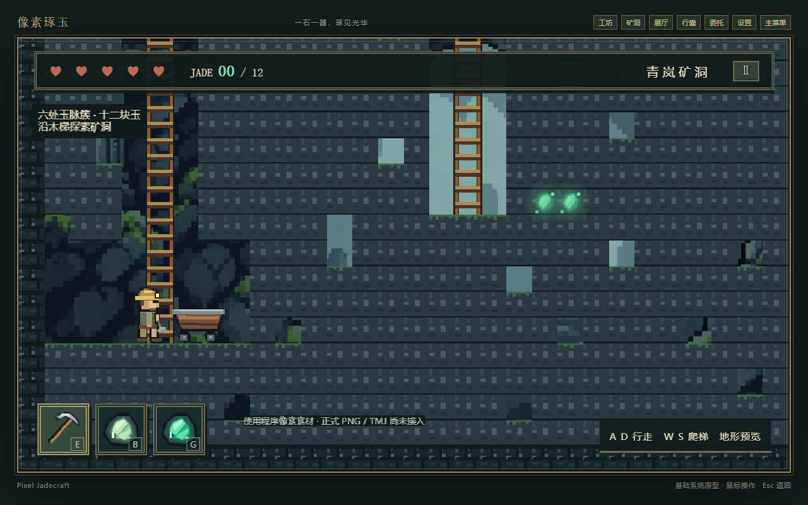
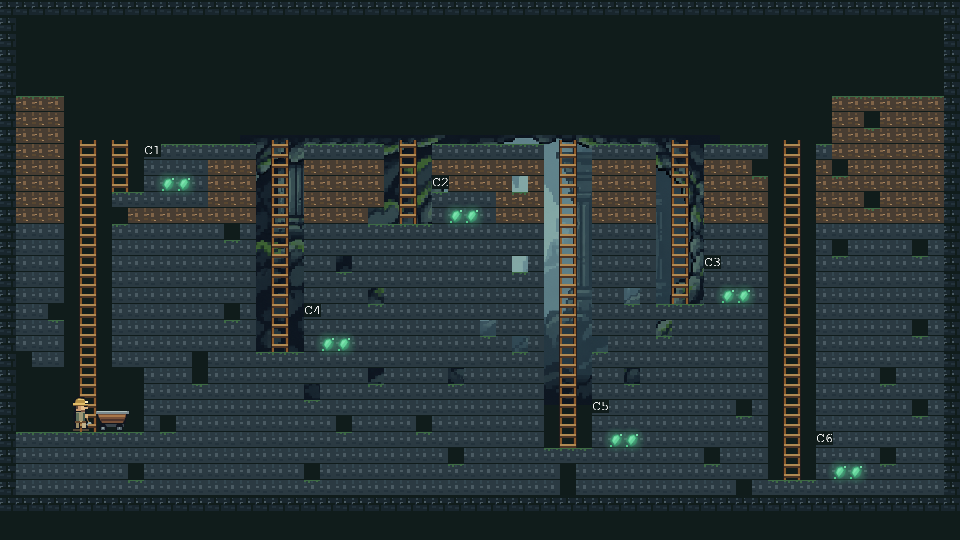

# 矿洞 v3.1 阶段 1 · 地图与渲染验收

日期：2026-11-12。阶段 0 五项决定已由用户确认。本阶段完成地图与渲染语义，尚未完成阶段 2–4。当前矿洞为地形预览，旧固定矿点采集入口已断开；跳跃、逐格挖掘、掉落、矿灯与永久存档标记在后续阶段接入。

## 文件 → 改动 → 结果

| 文件 | 改动内容 | 验收结果 |
| --- | --- | --- |
| src/mining.js | 新增确定性生成器、五类 tile、六簇十二来源、顶部主巷与七条梯子、24×56 实时碰撞盒 | seed 重现、独立数组、边界、出生室、保护圈、梯井净空测试通过 |
| src/mine-map.js | TMJ 只提供 kind / hardness 帧映射和脚底出生点；拒绝旧布局契约 | 合成正确及非法元数据测试通过；正式 TMJ 缺席 |
| src/mine-art.js | 五类 16×16 程序像素帧、2× 地形、AIR 不绘制、苔藓边缘、复用矿工与矿车 | Chrome 实际渲染截图已检查；为程序占位，未宣称概念图相似度 |
| src/mine-scene.js | 渲染新地形；错误素材可见反馈；角色 48×72；旧矿点入口暂停 | 出生落地、工坊往返、无页面异常通过；真实六簇行动尚未验收 |
| src/runtime.js | 持有当前地形对象，sessionRevision 改变时清除 | 场景往返保持对象；完整存档生命周期待阶段 3 |
| src/ui.js | 矿洞键位说明改为当前地形预览能力 | 不再误示空格挥镐；工坊布局/文案/坐标未变 |
| src/mining.test.js | 替换旧地图/Tiled/路线测试，新增六项地形测试 | 全仓 38/38 通过，含仍隔离保留的旧采集规则测试 |

## 截图

出生画面为完整生产构建页面，Chrome 157.0.8103.39、1280×800 窗口，画布逻辑尺寸 960×540。角色实际落地 y≈863.99，与 y=864 地面一致。

全图检查使用仓库外评审入口导入同一 createMineScene / drawRuntimeTerrain，关闭跟随、相机缩放至 0.5，添加 C1–C6 标签并隐藏场景说明；未以示意图替代运行结果。截图窗口为 960×540。背景本身仍为原 960×540 屏幕背景，在全图缩放模式只覆盖部分区域，这是评审镜头的表现，正常游戏相机不缩放。

## 检查结果和边界

- npm test：38 通过，0 失败。旧固定矿点的八项规则测试暂留，当前场景不再调用旧采集流程；阶段 2 完成新接口后清理旧实现与测试。
- npm run build -- --outDir E:/Pixel_Jadecraft-builds/mine-v3.1-stage1：通过，沿用既有 >500 kB 包体提示。
- git diff --check：通过。
- 浏览器：Chrome 157.0.8103.39，无页面错误，工坊→矿洞往返通过。Edge、暂停输入、六簇实际行走、挖掘、拾取及 FPS 尚未验收。
- 现有背景、矿工、矿车复用；没有下载或引入第三方素材。正式 tiles-mine.png、player-32x48.png、mine.tmj 仍待人工产出，替换点见 PROJECT_PLAN。
- mineVeins 规则已获确认；生成器支持按传入标记替换玉脉为 STONE，但 Store 尚未增加该字段，不能宣称防重复产出已经交付。
- 当前为地图阶段，挖掘暂不可用。下一阶段接入 176px/s、-420 跳跃、1200 重力、鼠标/E 挖掘、damage、拾取和暂停清理，再删除旧固定矿点代码。
- package-lock.json、概念图原件、DESIGN_SYSTEM.md 均未修改。未提交、未推送 Git。

任务书第 10 节要求每阶段人工确认。本阶段截图、规则和代码已具备可检查结果，后续功能尚未进入验收。
