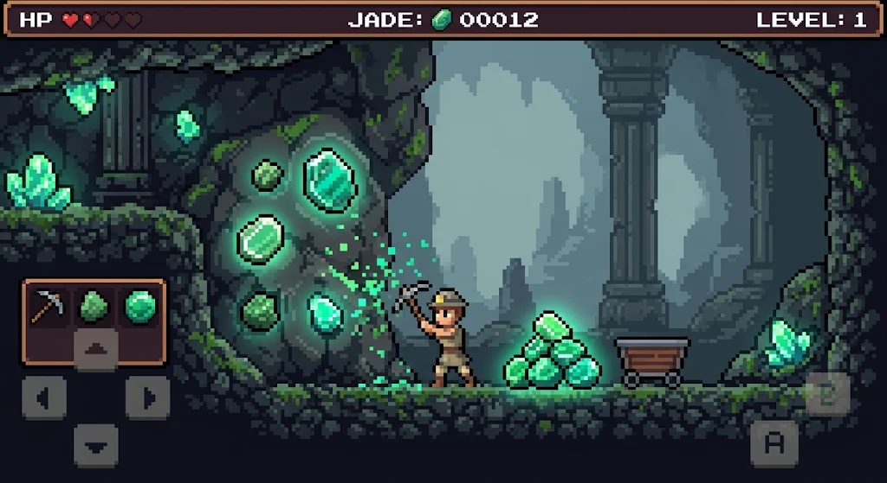
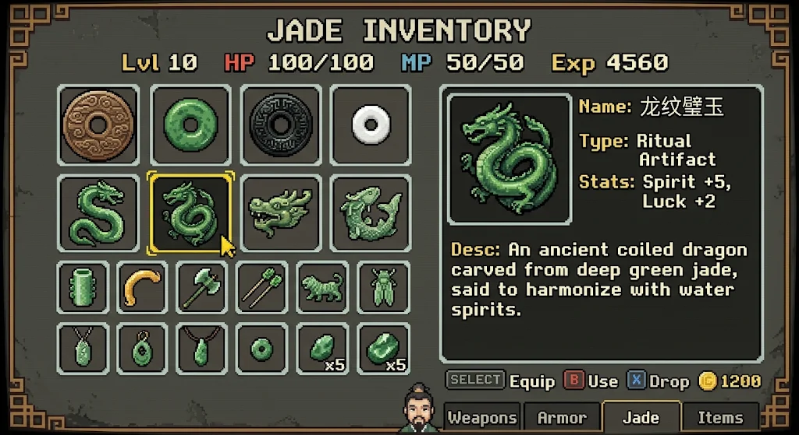
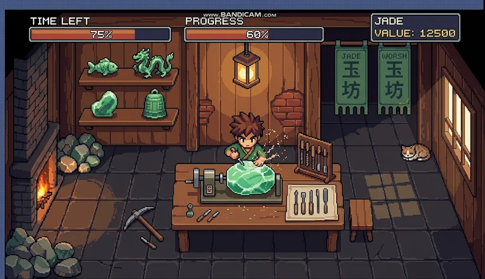
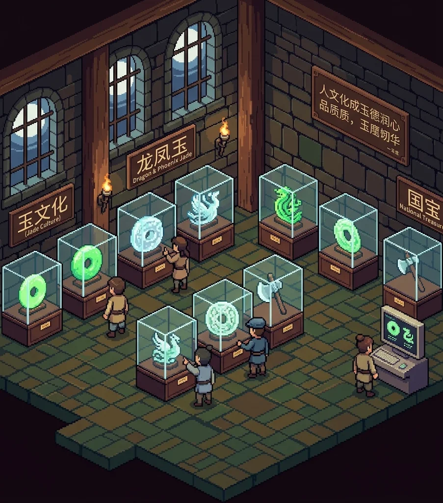
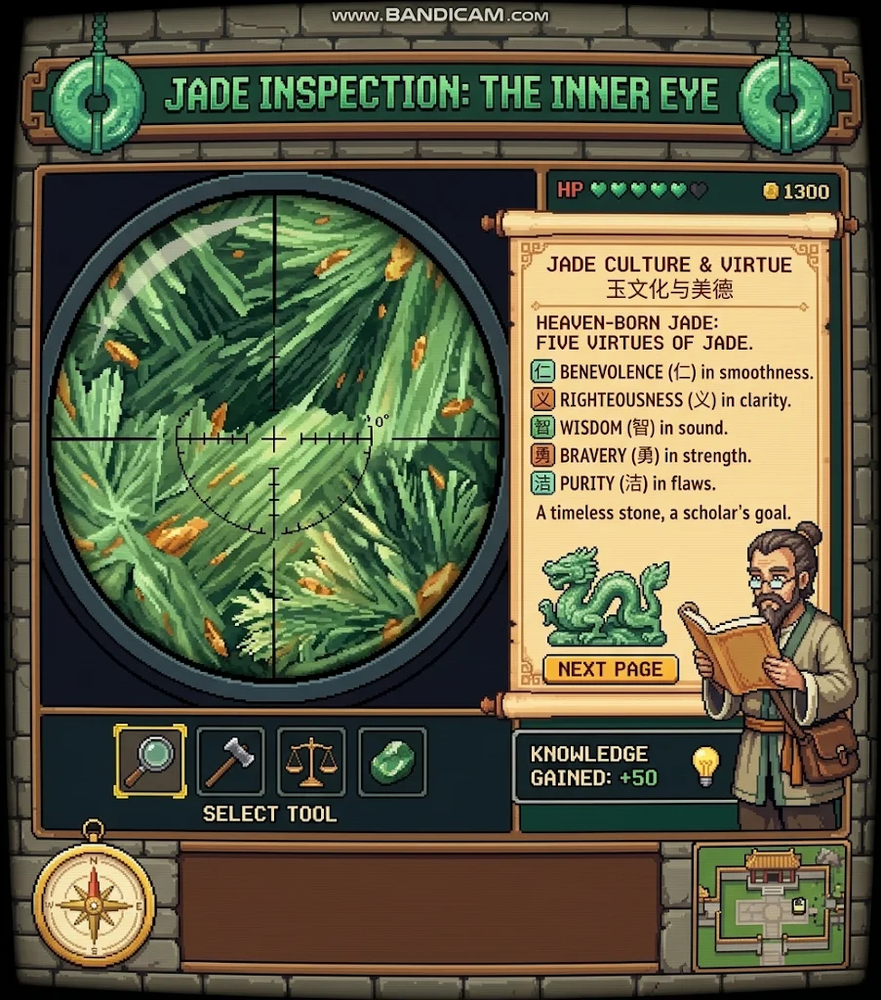
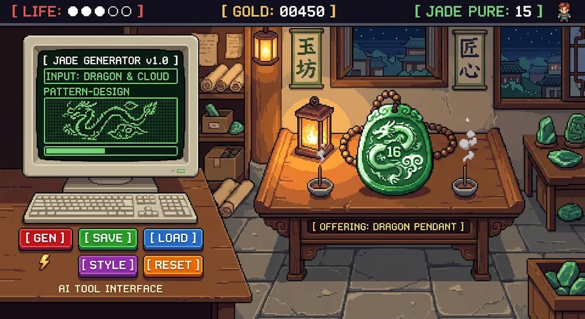
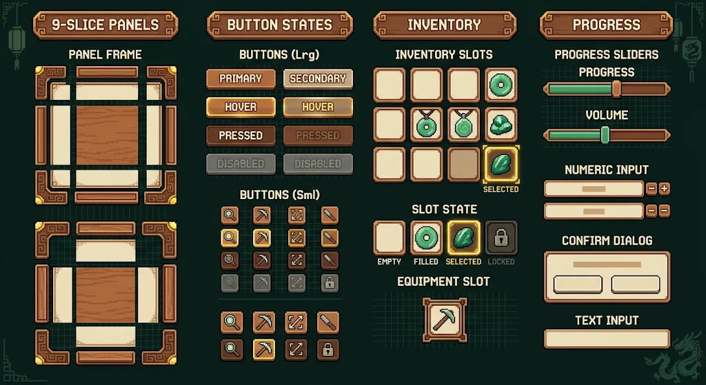
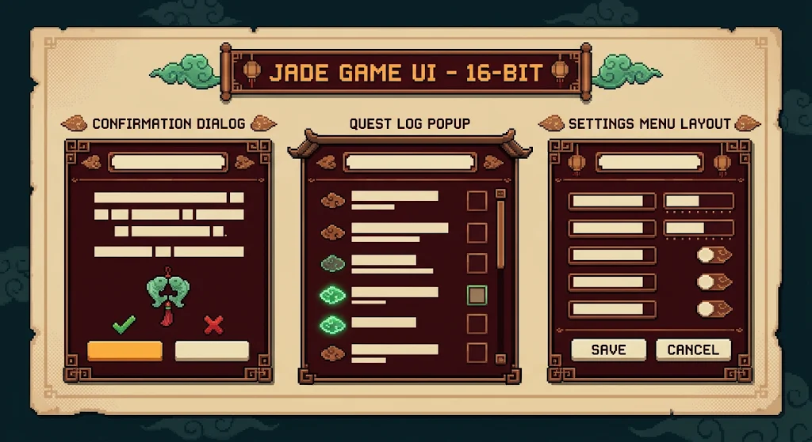
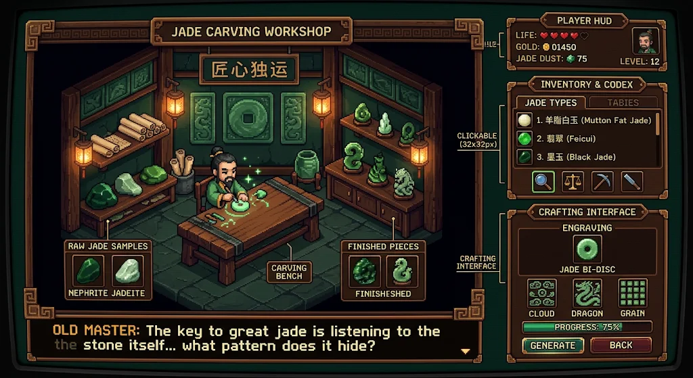
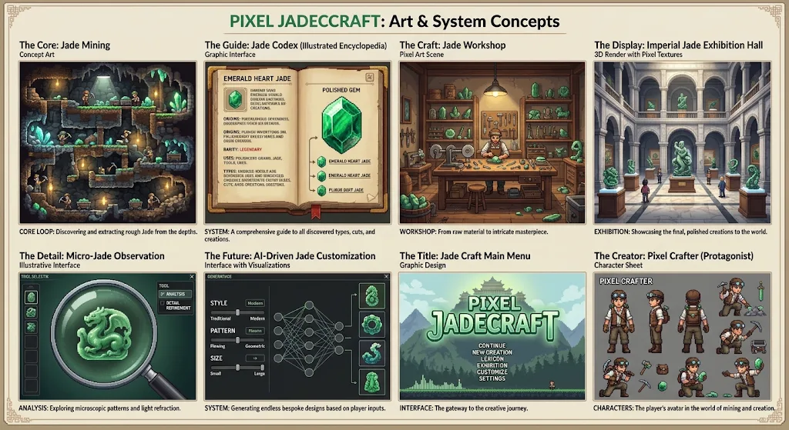

# Pixel Jadecraft（像素琢玉）概念图集

用户于 2026 年 11 月 10 日提供的视觉参考，展示像素风玉文化游戏的场景、氛围和交互构想。图中界面文字、数值和 AI 面板作为概念表达，实际功能以[项目计划](../PROJECT_PLAN.md)为准。

原始附件共七张，其中两张展厅图的 SHA-256 一致，归档为六张独立图片。图片按原文件完整保存，保留原有文字和水印。素材的制作来源和授权信息待补充。

2026 年 11 月 11 日新增本次聊天中的四张 UI 与场景参考，归档编号为 07–10。当前图集共十张图片，对应的已确认视觉与交互方案见[设计框架](../../DESIGN_SYSTEM.md)。

## 矿脉探索与原石采集

矿洞地形、发光原石、采矿动作与青绿色光效的参考。

## 背包与玉器图鉴

网格物品栏、玉器图标与文化详情面板的参考。

## 玉雕工坊

暖色木屋、工作台、工具和加工反馈的参考。

## 像素数字展厅

等距房间、玻璃展柜、展签与参观氛围的参考。

## 玉石微观鉴赏

观察工具、纹理示意和玉文化知识卡的参考。

## 纹样定制

纹样预览、定制面板与玉佩展示的参考。

## 基础 UI 组件板

按钮、背包格子、工具图标、进度条与木铜边框的参考。聊天附件原名为 `codex-clipboard-b052d46d-4f32-4af0-9ca7-d7b96a8e0f4c.png`。

## 弹窗、任务日志与设置菜单

标题装饰、回纹包角、深红褐底板和面板构图的参考。聊天附件原名为 `codex-clipboard-ae54f165-917b-4090-bfa6-ea4998d0f38c.png`。

## 工坊整屏概念图

斜视工坊、人物、工作台、深绿墙面、暖灯与玉器陈列的参考。全景与俯视加工近景按设计框架衔接。聊天附件原名为 `af9f51d6d87f0d3e662c2885b356e8f3.png`。

## 整体美术与系统概念总览

矿洞、图鉴、工坊、展厅、鉴赏、定制、主菜单与角色的整体参考。展厅按已确认的中式二维等距方案制作。聊天附件原名为 `3019bf1983fd9c44d6fcd854e8f9c90d.png`。

