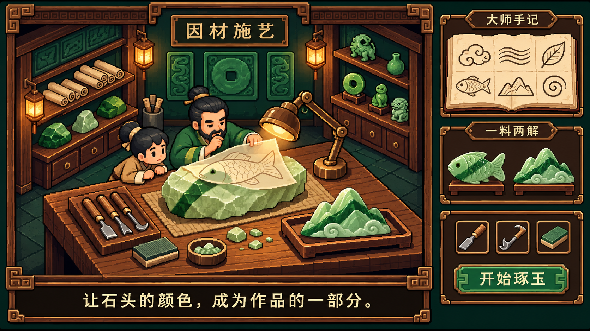
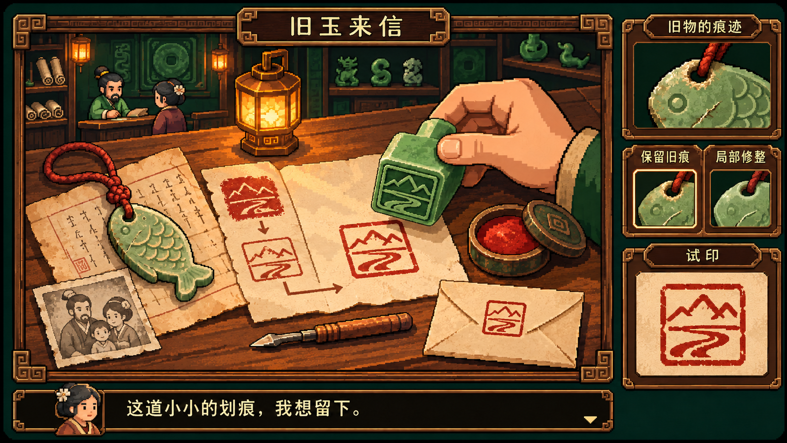
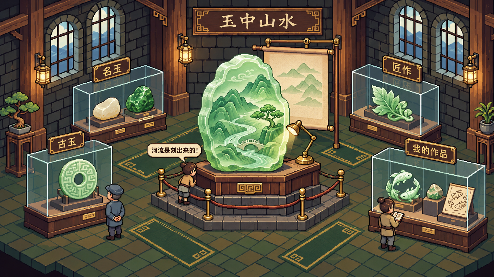

# 新玩法概念图 · 2026-11-15

用户要求根据 Pixel Jadecraft 项目及新玩法研究继续创作概念图。本组为内置 image_gen 生成的静态视觉提案，供讨论；不是实际游戏截图，不替代 docs/concept-art/01–10 原概念图，也不代表新玩法已实现或通过视觉验收。

## 图集

| 概念 | 图片 | 最终生成提示词 | 画面重点 |
| --- | --- | --- | --- |
| 大师手记与俏色工坊 | [PNG](01-material-led-workshop.png) | [提示词](01-material-led-workshop.prompt.md) | 借原石色带构图、六种纹样部件、同料鱼佩与山水两解 |
| 旧玉来信与试印台 | [PNG](02-heirloom-letter-and-seal.png) | [提示词](02-heirloom-letter-and-seal.prompt.md) · [对白修订](02-text-correction.prompt.md) | 旧物痕迹、来信、保留或修整、玉印试印与回信 |
| 玉中山水主题展厅 | [PNG](03-landscape-in-jade-gallery.png) | [提示词](03-landscape-in-jade-gallery.prompt.md) | 中央山水玉、侧灯、名玉/古玉/匠作/个人作品、不同观众 |

## 参考与边界

- 前两张使用原图 09（工坊界面）作为生成参考；第三张使用原图 04（数字展厅）。提示词还吸收了原图 07 的木铜组件和项目中文化要求。
- 沿用墨绿、木棕、古铜、米色、翠玉与琥珀灯色。三图均为横向像素风概念探索，精确像素网格、可交互控件和与原图的比例关系须在实现时继续校准。
- “玉中山水”是原创艺术幻想。图中的作品为游戏再创作，并非真实馆藏的准确复制。
- 印面与印迹在图中用于表达玩法；可执行的镜像、凹凸转印和试印规则仍须独立实现与验证。
- 第一张首次调用遇到网络错误，重试后成功。第二张底部对白经单独编辑，补齐为“这道小小的划痕，我想留下。”；本目录保存修订成图。
- 三张 PNG 均已打开核看，文件副本与生成原件 SHA-256 一致；尺寸依次为 1672×941、1671×941、1672×941。
- 本次未修改游戏代码、未替换已有素材、未提交或上传 GitHub。

## 预览

