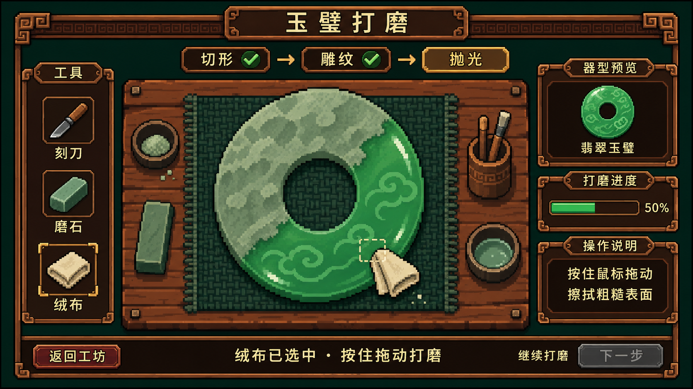

# 玉璧打磨近景样稿 V1

生成日期为 2026 年 11 月 11 日，使用内置 image_gen 工具，以已确认的工坊 V3 为风格参考。用户明确授权制作俯视打磨近景。



## 本稿内容

- 中央俯视工作台展示翡翠玉璧，粗糙灰绿层与已显露的翠色、云纹和高光共同呈现加工中状态，中央孔洞可见底垫。
- 左侧刻刀、磨石与绒布工具栏，绒布选中；小绒布与虚线范围表示接触位置。
- 顶部显示切形、雕纹、抛光阶段，右侧呈现器型预览、进度与操作说明，底部放置返回与下一步。
- 50% 为样稿演示进度，灰色下一步表现加工中状态。实际完成阈值和评分仍待规则设计及试玩。
- 桌面垫布、工具碗与工具筒为本稿构图尝试，待用户评审。

本稿为静态视觉样稿，待用户确认玉石大小、粗糙与抛光区域差异、工具遮挡和面板布局。正式实现时需统一像素网格、校对中文并动态渲染界面文本。样稿尺寸用于视觉评审，游戏逻辑分辨率仍待验证。

## 生成提示词

```text
Use case: ui-mockup.
Create a single 16:9 landscape game screenshot mockup for Pixel Jadecraft: jade bi disc polishing close-up, top-down view. Attached image is the APPROVED VISUAL STYLE REFERENCE, specifically its coarse pixel sprite texture, understated 3-tone shading, dark reddish brown recessed UI, thin weathered bronze frames, small narrow tab headers, square key-fret corners and dark ink green margins. Match its pixel-art material vocabulary closely.
The new screen is a TOP-DOWN craft workbench, detailed enough to read but coarse 16-bit pixel clusters with hard stepped edges and restrained 3-tone ramps. No fine painterly textures, no glossy beveled UI, no rendered 3D, no anime, no smooth vector outlines. Treat as a low-resolution 960x540 logical interface enlarged by nearest-neighbor, all details in a consistent chunky pixel grid. Calm dark workshop palette, emerald jade focal point, warm wood, aged copper borders, parchment text.
Composition:
Top narrow wooden heading reads "玉璧打磨". Below, centered compact stage strip "切形 → 雕纹 → 抛光", with 抛光 highlighted muted amber and first two stages marked completed.
Left compact vertical tool panel about 13 percent width reads "工具". Three small square coarse pixel icon buttons with labels "刻刀" "磨石" "绒布"; 绒布 selected with fine gold corner pixels. Tools remain small and practical.
Central work area about 60 percent width shows a top-down rectangular wooden work surface with restrained visible plank grain and a dark woven working pad. A large flat circular jade BI DISC lies centered and fully visible, diameter about 42 percent of screen height, ring with a genuine central round hole showing the pad underneath. Ring occupies enough area to demonstrate polishing.
Jade state: about half the annulus, upper-left side, has a matte opaque gray-green rough stone crust using broad flat stippled pixel clusters; lower-right side has revealed rich emerald/celadon jade with a few restrained crisp highlights and a lightly visible carved cloud pattern. Irregular diagonal organic transition between matte and polished sections, WITHOUT a straight comparison split. Both rough and polished halves share one continuous ring silhouette and circular hole. Only effective annulus is polishable; central hole stays open. A small folded cream polishing cloth cursor touches the transition at lower right, with a tiny clear dashed square contact outline, only a few small pale dust pixels. Tool must not obscure jade.
Right about 22 percent width, three compact dark wood-bronze panels matching reference style: top "器型预览" with small completed polished bi icon and label "翡翠玉璧"; middle "打磨进度" with a thin green bar filled exactly half and text "50%"; bottom "操作说明" with concise cream Chinese lines "按住鼠标拖动" and "擦拭粗糙表面". Reference style small legible typography with generous internal breathing room.
Bottom narrow dark instruction area reads "绒布已选中 · 按住拖动打磨". Small wood button bottom left "返回工坊". Bottom right subdued disabled-looking button "下一步" with small adjacent text "继续打磨". No character, no room panorama, no dialogue box, no unrelated inventory or quest panels. UI crisp and compact, central jade is the main focal point.
Text in quotation marks must be exact Chinese, clean and legible. Preserve the approved reference's restrained worn copper/wood framing, deep green and brown color balance, coarse economical pixels. This is a visual design proposal screenshot, not a technical diagram.
```

