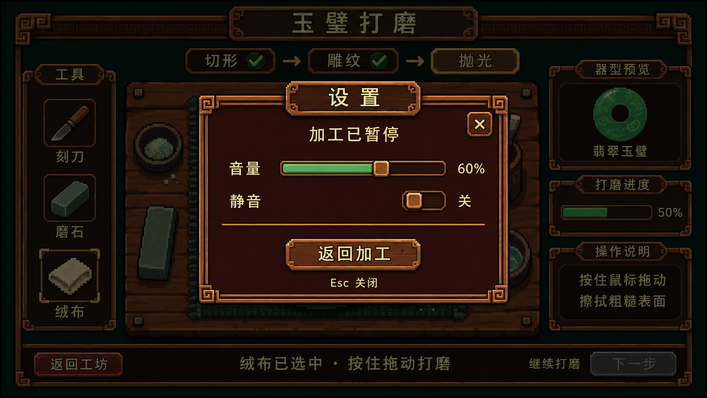

# 设置弹窗历史样稿 V1

2026 年 11 月 11 日使用内置 image_gen 工具，以打磨近景与弹窗组件板为输入制作。



用户随后明确要求基础 UI 与弹窗设置直接采用原概念图，达到 95% 的视觉接近目标。最新制作依据见[设计系统的面板与组件规范](../../DESIGN_SYSTEM.md)，设置面板采用[原弹窗板右侧](../concept-art/08-dialogs-and-menus.png)的竖向比例、深红底板、平直双线结构、回纹角饰、米色控件和底部双按钮。本图作为历史尝试保留。

本图音量 60% 为演示数据，背景加工状态为静态图示。

## 生成提示词

```text
Use case: precise-object-edit / ui-mockup.
Create Pixel Jadecraft polishing-screen SETTINGS MODAL mockup by editing input image1. Input image1 is the base polishing screenshot. Input image2 is a secondary reference for traditional Chinese dark-wood dialog frame craftsmanship only.
Keep image1 canvas proportion 16:9 and preserve its top-down workbench, jade disc with rough and polished halves, tools, stage navigation, side panels, and bottom controls in their original positions. Apply a uniform dark translucent overlay over the entire base screen, about 55 percent dimming, with crisp underlying pixels still recognizable. No blur. Add one centered settings modal floating on top. The modal is the clear focal point while the darkened jade disc and UI remain visible around its margins.
Match approved coarse 16-bit pixel style: economical stepped pixel clusters, short restrained 3-tone shading ramps, thin worn bronze edging, deep reddish brown wood recessed panel, small square key-fret corners. Avoid fine painterly textures, glossy bevels, smooth rounded cards, modern UI, stone arches and heavy bloom.
Modal rectangular, about 42 percent canvas width and 60 percent canvas height, centered, ample padding. Frame dark wood with thin antique copper double edging, compact square key-fret ornaments only at four corners. A narrow wooden tab header centered on top reads exactly "设置". Small square bronze close button "×" at upper right inside frame.
Under header small centered parchment status text "加工已暂停".
One clean row with label "音量" on left, a horizontal recessed wood slider to its right, filled muted jade green to 60 percent with a small bronze square knob, and small "60%" value at far right.
Second row with label "静音" on left and a small traditional pixel toggle at right, currently OFF: dark track, bronze square thumb on left, nearby small text "关". The slider and toggle align to the same right-side column with comfortable spacing.
Subtle horizontal bronze divider.
Centered lower button, medium-sized worn wood, muted bronze outline, cream text "返回加工".
Small subdued cream footer text inside modal "Esc 关闭".
Only the above essential labels, no extra settings, no save or cancel pair, no decorative numbers, no copied English. All text clean readable Chinese. The close button and Return-to-crafting button have clear hit areas.
Read the mood of reference2, but fit this compact settings modal to image1's darker copper-and-wood language. Underlying screen stays dim, foreground modal fully lit. This is a static UI design proposal that communicates paused background processing and volume settings.
```
