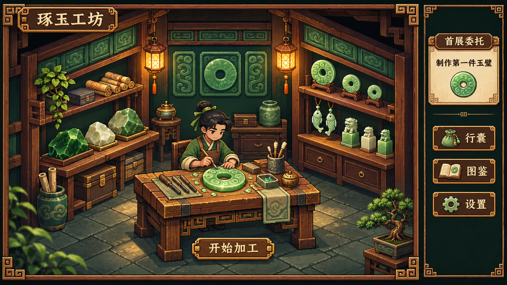

# 工坊全景视觉样稿 V1

生成日期为 2026 年 11 月 11 日，使用内置 image_gen 工具。此稿用于评审空间构图、木铜材质、暖灯与翠玉关系、人物和工作台位置，以及右侧信息占比。



参考图为 ../concept-art/09-workshop-interface.png 与 ../concept-art/07-ui-components.png。布局尝试采用场景约 84%、右侧栏约 16%，属于首稿试排参数，待用户评审。标题、委托文字和按钮在概念样稿内生成，正式界面按设计规范动态渲染文字。

本稿细节偏细腻，人物及部分纹理呈插画感，统一逻辑像素尺度需要继续校正。样稿画布尺寸用于视觉评审，最终游戏逻辑分辨率待验证。

## 生成提示词

```text
Use case: ui-mockup.
Create the first high fidelity visual design draft for Pixel Jadecraft, a Chinese jade craft pixel-art game. Single 16:9 landscape game screenshot, polished detailed 16-bit pixel art with consistent crisp pixel clusters, warm calm handmade atmosphere.
Reference image 1 is visual style and workshop composition reference. Reference image 2 guides wooden-bronze UI frames and jade icons. Produce an original proposed workshop overview following those references closely in material richness and pixel craft.
Composition: workshop interior occupies about 84 percent of the screen, narrow collapsed information strip occupies right 16 percent. Oblique cutaway view into intimate traditional Chinese jade workshop, dark emerald green back walls, warm wooden beams, two warm amber lanterns. Central wooden carving workbench at bottom-middle with a clearly visible bright green jade bi disc and carving tools. A modest young Chinese craft apprentice wearing green and brown works behind the table. Left bench holds rough emerald and creamy white jade, right shelves show a few refined jade bi discs, jade fish pendants and small jade seals. Quiet detailed stone tiled floor with space to breathe. Give workshop functional readable paths and furniture.
UI: restrained wooden and bronze perimeter with small key-fret corner ornaments, deep ink green #101C1B surround, parchment text. Small top-left wooden title reads exactly "琢玉工坊". Narrow right strip has only a compact quest card reading "首展委托" and "制作第一件玉璧", and three discrete icon buttons reading "行囊", "图鉴", "设置". Bottom middle small wood button adjacent to workbench reads "开始加工". No dialogue box open in this state. Keep jade object and apprentice as focal point. Side strip stays compact, never becomes a large open inventory. Chinese text must be clean and readable.
Materials: warm timber grain, bronze corners, muted gold edge accents, jade deep green shadows and delicate translucent-looking lime/celadon highlights, small restrained glints. Match references' tactile pixel art richness and shadow layering. Light pools around lamps and table; all main objects remain visible.
Avoid English, decorative explanatory labels, HP, coins, levels, AI controls, futuristic elements, photorealism, smooth vector art, excessive bloom, watermark. This is a workshop overview mockup for evaluating visual direction; detailed editing view comes later.
```

