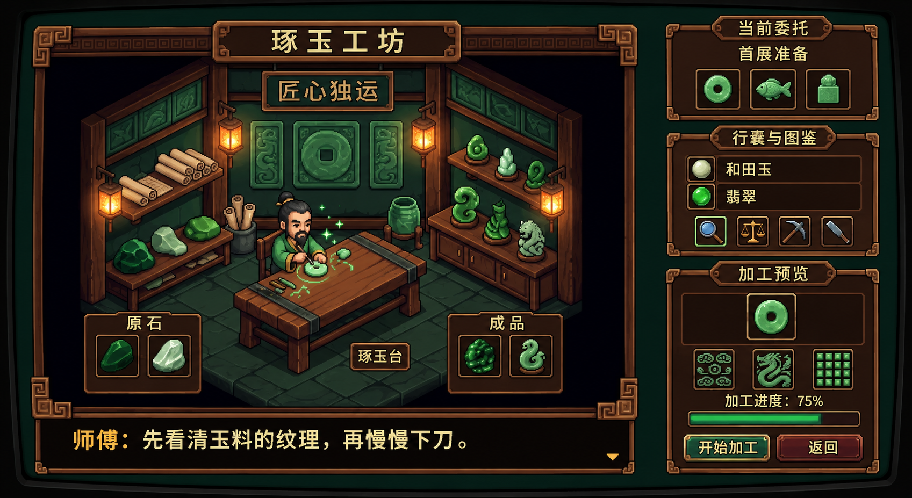

# 工坊全景视觉样稿 V2

生成日期为 2026 年 11 月 11 日，使用内置 image_gen 编辑工具。用户反馈 V1 过于细腻且偏离概念图，要求贴近再次提供的工坊参考。本稿以该参考图直接编辑，恢复小比例师傅、斜视桌面、简洁明暗、深色背景、右侧三段面板和底部对话布局。布局按参考图试排，最终面板展开方式待用户评审。



V1 作为先前尝试保留，最新视觉评审使用 V2。用户对粗粒度像素风及参考构图的明确要求优先于此前“细腻”的概括。材质通过有限层次色块表现。生成图中文字与像素网格仍需后续校对，正式界面文字动态渲染。V2 待用户评审。

参考图对应 ../concept-art/09-workshop-interface.png，用户本次附件名为 codex-clipboard-40f27558-541b-424b-9176-b5a87e949a9f.png。

## 生成提示词

```text
Use case: precise-object-edit / ui-mockup.
Edit the attached workshop concept image into a faithful Chinese-language Pixel Jadecraft workshop mockup. The attached image is the authoritative edit target and visual standard. Preserve its composition, geometry, small-scale pixel sprites, dark exposure, restrained shading, palette and object positions extremely closely.
Keep identical relative proportions: left workshop scene and bottom dialogue together about 70 percent width; right three stacked framed UI panels about 25 percent width. Same oblique room perspective, same small bearded jade craftsman behind the modest table, same tool placement, dark tiled floor, left rough jade table, right jade shelves, back wall hanging jade bi and small carved plaques. Retain generous dark space around scene. Keep the same low-resolution coarse 16-bit pixel art, clearly visible chunky square pixel clusters, compact sprites, hard stair-step silhouettes, short 3-tone color ramps. Maintain restrained small lantern pools, modest jade highlights, thin brown-bronze frames and square key-fret corners. Everything must look like a direct close variant of the source.
Change only the following UI writing/content to a concise Chinese layout. Top workshop title "琢玉工坊". Back wall sign retain "匠心独运". Upper right panel title "当前委托", inside "首展准备" and three tiny distinct jade bi, jade fish, jade seal icons. Middle right panel title "行囊与图鉴", show only two material rows with jade icons and labels "和田玉" and "翡翠", then the same four little tool buttons. Lower right title "加工预览", same small jade bi preview, three pattern thumbnails, a green progress bar, buttons "开始加工" and "返回". Bottom dialogue text "师傅：先看清玉料的纹理，再慢慢下刀。". Left bottom samples panel short title "原石", right bottom finished pieces panel title "成品". Remove external annotation callouts such as CLICKABLE and CRAFTING INTERFACE and their bracket leader lines, keeping the gaps dark.
Fidelity constraints: preserve the attached image's room scale and UI arrangement. Source is approximately 1024x559; aim for this landscape proportion and same modest source pixel density. Do not redesign furniture, enlarge character, make glossy illustration, add plants, add foliage, add sculpted elaborate furniture, add volumetric light, add fine texture noise, add smooth gradients, add depth of field, add anime portrait, or add a wide bright parchment sidebar. Maintain the compact brown dark UI shown in the target. Crisp discrete pixels throughout.
```

