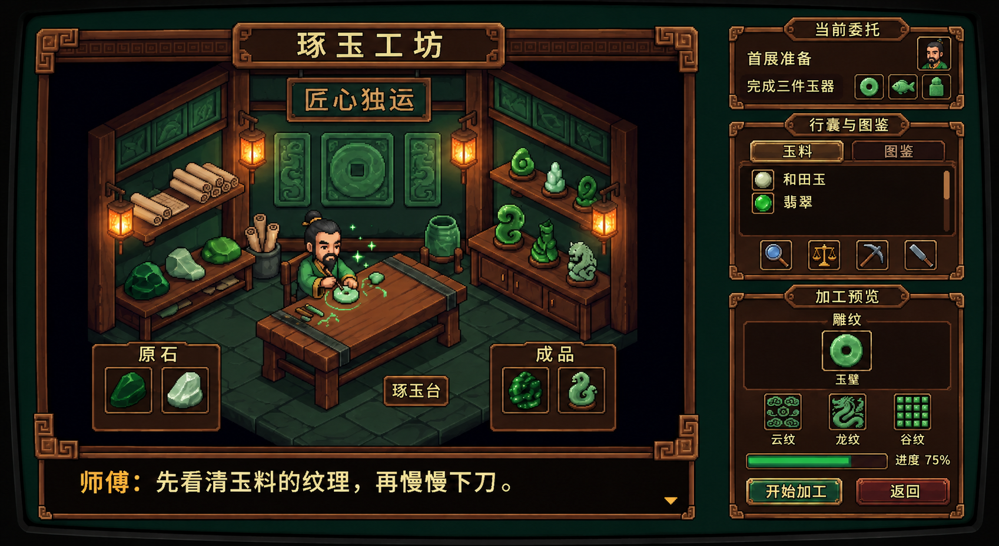

# 工坊侧栏视觉样稿 V3

2026 年 11 月 11 日，使用内置 image_gen 工具编辑 V2，以原工坊概念图校准侧栏。用户要求侧栏继续贴近参考图，尤其是材质质感。



本轮调整为更紧凑的委托区、窄标题牌、细铜边、深色凹槽列表、小图标、材料与图鉴页签，以及带纹样名称的加工预览。面板明暗与间距按原参考收敛。用户于 2026 年 11 月 11 日回复“ok”，确认本轮侧栏视觉方向，后续加工近景与弹窗以此为视觉依据。图像编辑仍需后续校正文字与统一像素网格，进度 75% 为演示内容。

## 生成提示词

```text
Use case: precise-object-edit. Input image 1 is the edit target, the current Chinese Pixel Jadecraft workshop mockup. Input image 2 is the authoritative appearance reference for the sidebar.
Edit ONLY the right sidebar in image 1 (approximately x=72% to 97% of image width). Preserve the entire left workshop scene, craftsman, table, room perspective, lamps, outer frame, title and bottom dialogue exactly. Keep output canvas aspect ratio identical to image 1.
Restyle sidebar very closely to image 2. Match its compact small typography, fine weathered bronze pixel borders, subtly irregular wood edging, tiny corner brackets, black-brown recessed wells and flat dark reddish brown panels. Thin restrained bronze accents. Replace image1's oversized shiny title plaques and oversized text with the much smaller, narrower tab-shaped labels seen in reference. Simplify highlights into hard stepped pixel clusters, 2-3 tone ramps, restrained shading, no glow around borders. All icons use the reference's small coarse pixel sprite density. Avoid glossy gradients, excessive beveling, smooth vector outlines, large round gem icons.
Three stacked panels aligned along same vertical sidebar:
Top compact panel about 16 percent sidebar height, heading "当前委托", small square craftsman portrait upper right, two compact rows "首展准备" and "完成三件玉器", three tiny bi-disc, fish and seal markers. Keep dark empty pixels around rows.
Middle panel about 34 percent sidebar height, heading "行囊与图鉴". Two compact inset tabs "玉料" and "图鉴". Recessed nearly black item list with small square material icons at left, two fine Chinese text rows "和田玉" and "翡翠", slim wood scrollbar at far right. List has open space rather than large boxed rows. Bottom a compact row of four small brass-trim pixel tool buttons loupe, scales, pickaxe, carving knife, closely matching reference image2. Moderate small padding, fine outlines.
Bottom panel about 43 percent sidebar height, heading "加工预览", small stage subheading "雕纹". Recessed preview well containing a modest pixel jade bi disc centered, beneath it small label "玉璧". Three compact square pattern tiles and tiny labels "云纹" "龙纹" "谷纹". Thin green progress bar with small text "进度 75%". Bottom pair of small worn wood buttons labeled "开始加工" and "返回". Keep all text comfortably within frames.
Use narrow dark gaps between panels as in reference image2, overall panel proportions following reference (top clearly shorter, middle and bottom taller). Chinese lettering cream parchment color, headings muted gold, green subdued with 3 discrete tones. Match the reference's understated, aged, compact game UI texture and pixel geometry. Maintain source image1's overall scene clarity and color balance. No new gameplay currencies, hearts or level numbers.
```

